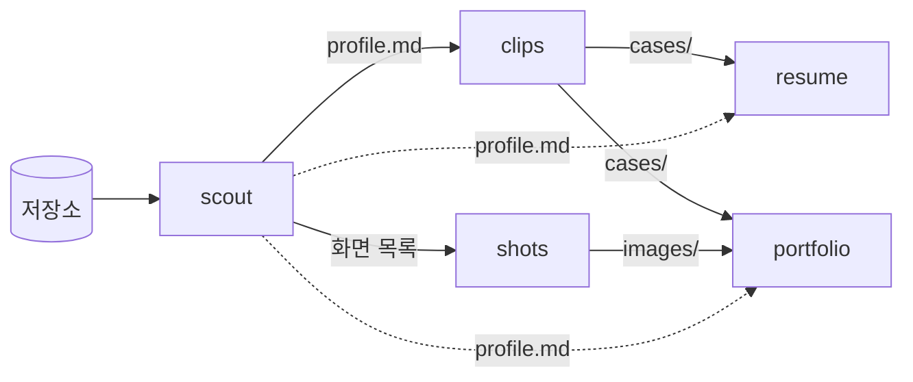

<div align="center">

# reel

**커밋 수백 개 속에서 명장면만 골라, 이력서와 포트폴리오로 엮습니다.**

경기 전체를 다시 보여 주는 대신 결정적인 장면만 모은 하이라이트 릴처럼,<br>
프로젝트 저장소에서 이야기할 만한 순간을 찾아 바로 쓸 수 있는 원고로 편집하는 Claude Code 플러그인입니다.


</div>

---

## 한눈에 보기

프로젝트 저장소(코드 · git 이력 · 문서)를 읽고, 그 프로젝트 루트의 `work/` 폴더에 두 가지를 만들어 줍니다.

- **원고(md)** — 이력서 · 경력기술서 · 포트폴리오에 그대로 옮겨 쓸 수 있는 글
- **화면 이미지** — 포트폴리오 갤러리와 이력서 아이콘에 쓸 스크린샷

결과물의 기준은 `~/Desktop/Portfolio`에 있는 두 파일입니다. 경력기술서는 `resume/resume.md`, 포트폴리오 사이트 데이터는 `src/data/projects.ts`의 형식을 따릅니다.

```bash
cd <분석할 프로젝트>
claude --plugin-dir /Users/limjeongsik/Desktop/reel
```

```
/reel:cut all
```

<br>

## 명령과 스킬

| 이름 | 역할 | 하는 일 |
|:--|:--|:--|
| **`/reel:cut`** | 감독 | 처음부터 끝까지 한 편을 뽑습니다. 모드: `all` · `resume` · `portfolio` · `images` |
| `scout` | 정찰 | 저장소를 읽고 근거를 모읍니다 |
| `clips` | 장면 고르기 | 기술 사례를 골라 전/후 코드와 함께 잘라 냅니다 |
| `resume` | 편집 · 고르기 | 지원서에 넣을 내용을 고르는 문서를 만듭니다 |
| `portfolio` | 편집 · 보여 주기 | 작업을 보여 주는 문서를 만듭니다 |
| `shots` | 촬영 | 스크린샷과 이미지를 준비합니다 |

### 모드별 흐름

`/reel:cut`은 항상 `scout`로 시작하고, 모드에 따라 아래 순서로 이어집니다.

| 모드 | 순서 |
|:--|:--|
| `all` (기본) | scout → clips → shots → resume → portfolio |
| `resume` | scout → clips → resume |
| `portfolio` | scout → clips → shots → portfolio |
| `images` | scout → shots |

`scout`가 끝나면 확인이 필요한 항목을 먼저 물어봅니다. "나중에"라고 답하면 `TODO`로 남겨 두고 계속 진행합니다.

<br>

## 어떻게 이어지나



| 스킬 | 입력 | 출력 | 핵심 |
|:--|:--|:--|:--|
| `scout` | 저장소 | `profile.md` | 근거부터 모읍니다. 어떤 커밋이 "내 것"인지 정하고, 숫자는 실제 명령을 돌려서 셉니다 |
| `clips` | profile | `cases/` | 전/후 코드를 git에서 그대로 발췌합니다. 원인이 한 겹 아래 숨어 있던 문제를 우선 고릅니다 |
| `resume` | profile, cases | `resume.md` | 칸 길이에 맞춰 미리 잘라 둔 원고입니다. 경력에는 역할과 영향을, 프로젝트에는 기술 문제를 씁니다 |
| `portfolio` | profile, cases, images | `portfolio.md` | 포트폴리오 사이트의 `Project` 타입과 같은 필드 단위로 씁니다 |
| `shots` | profile의 화면 목록 | `images/` | 이미 있는 이미지를 먼저 쓰고, 웹은 Playwright로, 앱은 시뮬레이터나 adb로 찍습니다 |

모든 스킬이 함께 따르는 규칙은 `shared/`에 있습니다.

- `writing-rules.md` — 근거 · 조건 · 중복 금지 · 문장 원칙
- `work-layout.md` — `work/` 폴더 구조와 파일 이름 규칙

<br>

## 결과물 — `work/`

| 파일 | 담는 내용 | 쓰는 곳 |
|:--|:--|:--|
| `profile.md` | 스택 · 기간 · 내 기여 · 화면 목록 · 사례 후보 · 실측값. 모든 항목에 근거를 붙입니다 | 다른 원고의 근거 |
| `cases/NN-*.md` | 기술 사례 하나당 파일 하나. 문제 → 해결 → 전/후 코드(커밋) → 결과 → 면접 포인트 | 모든 원고의 원재료 |
| `resume.md` | 이력서 요약 3줄 · 경력 bullet · 경력기술서 상세 · 길이별 자기소개 · 예상 면접 질문 | 이력서 PDF, 지원서 입력 칸 |
| `portfolio.md` | 카드 · 배경 · 접근 방식 · 사례(코드 포함) · 화면 표를 사이트 필드 단위로 | 포트폴리오 사이트, 노션, PDF |
| `images/` | `<slug>-screen-NN(-dark).webp`, `-icon`, `-thumb`, `-sheet-*`와 설명 파일 `images.md` | 사이트 갤러리, 이력서 아이콘 |
| `README.md` | 만든 파일과 쓰임, 남은 `TODO` 모음, 찍지 못한 화면 | 다음에 이어서 작업할 때 |

<br>

## 편집 원칙

`~/Desktop/Portfolio` 저장소의 편집 원칙을 그대로 가져왔습니다.

1. **수치는 실측값만 씁니다.** 저장소에 기록된 숫자만 쓰고, 모르는 값은 `<!-- TODO -->`로 남깁니다.
2. **코드는 손대지 않고 발췌합니다.** git 이력에 있는 그대로 옮기고, 줄일 때는 `// ...`만 씁니다.
3. **확인 수준을 정직하게 밝힙니다.** 실기기에서 확인했는지, 테스트로 고정했는지, 정적 검증만 했는지 구분합니다.
4. **조건이 있으면 조건을 붙입니다.** OS나 기기에 따라 달라지는 내용은 그 조건을 함께 적습니다.
5. **두 문서의 역할을 나눕니다.** 이력서는 고르는 문서, 포트폴리오는 보여 주는 문서입니다.

<br>

## 준비물

| 항목 | 필요한 것 | 비고 |
|:--|:--|:--|
| 저장소 | git 저장소 | 필수는 아니지만, 전/후 코드와 커밋 근거가 있어야 결과가 좋습니다 |
| 웹 캡처 | Node(`npx`), Playwright 1.64.1 (Chromium r1248) | 브라우저가 없으면 `npx playwright@1.64.1 install chromium-headless-shell` |
| 이미지 변환 | `cwebp` | `brew install webp` |
| 앱 캡처 | Xcode 시뮬레이터(`xcrun simctl`) 또는 Android `adb` | 앱 프로젝트일 때만 |

<br>

## 설치

**GitHub에서 설치하기**

```
/plugin marketplace add LimjeongSik/reel
/plugin install reel@reel
```

**폴더를 바로 불러오기**

```bash
cd <분석할 프로젝트>
claude --plugin-dir /Users/limjeongsik/Desktop/reel
```

**로컬 마켓플레이스로 설치하기**

```
/plugin marketplace add /Users/limjeongsik/Desktop/reel
/plugin install reel@reel
```

<br>

## 폴더 구조

```
reel/
├── .claude-plugin/          plugin.json · marketplace.json
├── commands/
│   └── cut.md               /reel:cut [all|resume|portfolio|images] [경로]
├── agents/
│   └── scout-analyst.md     큰 저장소의 하위 영역 조사용 (읽기 전용)
├── shared/
│   ├── writing-rules.md     공통 작성 원칙
│   └── work-layout.md       work/ 폴더 규칙
└── skills/
    ├── scout/
    ├── clips/
    ├── resume/
    ├── portfolio/
    │   └── references/site-fields.md     사이트 필드 대응표
    └── shots/
        └── scripts/         capture-web.sh · capture-device.sh · to-webp.sh
```

<br>

## 다음 할 일

- [ ] 실제 프로젝트로 돌려 보고, 결과를 `~/Desktop/Portfolio/resume/resume.md`와 비교해 스킬 다듬기
- [ ] 영문 이력서 버전 추가
- [ ] 여러 프로젝트를 묶어 이력서 전체(`content.js`)를 만드는 스킬
