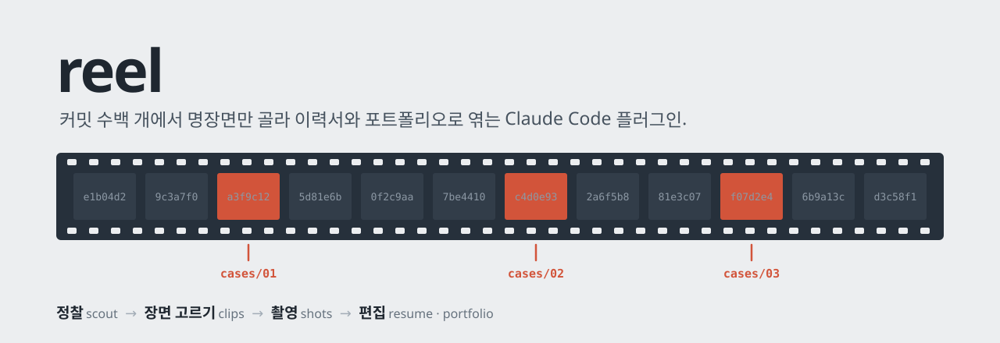

<p align="center">
  
</p>

이력서에 프로젝트를 쓰려고 하면 커밋 수백 개를 다시 뒤지게 됩니다. 무엇을 했는지는 기억나도, 어떤 문제를 어떻게 풀었는지, 그 전후 코드가 어땠는지는 흐려져 있습니다. reel은 그 일을 대신합니다. 프로젝트 저장소의 코드와 git 이력, 문서를 읽고, 이야기할 만한 장면만 골라 이력서 · 경력기술서 · 포트폴리오 원고로 편집합니다.

결과는 그 프로젝트 루트의 `work/` 폴더에 Markdown 원고와 화면 이미지로 남습니다. 모든 문장에는 근거가 붙고, 확인하지 못한 수치는 지어내지 않고 `TODO`로 비워 둡니다. 원고에 인용한 커밋 해시와 날짜는 스크립트로 실제 이력과 대조합니다.

## 설치

```
/plugin marketplace add LimjeongSik/reel
/plugin install reel@reel
```

설치한 뒤 Claude Code를 재시작하거나 `/reload-plugins`를 실행하면 `/reel:cut`을 쓸 수 있습니다.

### 설치한 뒤

분석할 프로젝트 폴더에서 실행합니다.

```
/reel:cut
```

인자 없이 실행하면 `all` 모드로 끝까지 진행합니다. 필요한 것만 뽑으려면 모드를 붙이고, 다른 폴더를 분석하려면 경로를 붙입니다.

| 명령 | 만드는 것 |
|---|---|
| `/reel:cut all` | 사례, 이미지, 이력서 원고, 포트폴리오 원고 전부 |
| `/reel:cut resume` | 사례와 이력서 원고 |
| `/reel:cut portfolio` | 사례, 이미지, 포트폴리오 원고 |
| `/reel:cut images` | 화면 이미지만 |
| `/reel:cut all ~/work/my-app` | 지정한 경로의 프로젝트를 분석 |
| `/reel:cut all --full` | 지난 분석 기록을 무시하고 처음부터 다시 분석 |

슬래시 명령 대신 "이 프로젝트로 이력서 원고 만들어줘", "트러블슈팅 사례 정리해줘", "포트폴리오용 스크린샷 찍어줘"처럼 말해도 됩니다. 스킬을 하나씩 따로 부를 수도 있습니다.

## 업데이트

> [!TIP]
> **이번 업데이트(0.4.0): 고친 원고는 지키고, 다시 돌릴 땐 바뀐 것만**
>
> - **덮어쓰기 보호:** 직접 고친 원고를 해시로 가려내서 덮어쓰지 않고 `*.new.md`로 비켜 씁니다. 실행할 때마다 원고를 백업합니다.
> - **증분 분석:** 다시 실행하면 지난번에 분석한 커밋 이후의 변경만 읽고, 새 사례 후보만 추가합니다. 바뀐 게 없으면 분석을 건너뜁니다.
> - **원고 검수:** 인용한 커밋 해시 · 날짜가 실제 이력과 맞는지, 참조한 이미지가 있는지, 사례 번호가 이어지는지 스크립트로 확인합니다.
> - **macOS 밖에서도 이미지 변환:** `sips`가 없으면 ImageMagick이나 `file`로 이미지 폭을 읽습니다.
>
> ```
> /plugin marketplace update reel
> ```

### 업데이트하는 법

**1. 마켓플레이스 목록 갱신**: 목록만 새로 받습니다. 이미 설치한 플러그인의 버전은 바뀌지 않습니다.

```
/plugin marketplace update reel
```

**2. 플러그인 업데이트**: `/plugin`에서 reel을 골라 업데이트하거나, 터미널에서 실행합니다. user 범위가 아닌 곳(project, local)에 설치했다면 `-s`로 범위를 지정합니다.

```
claude plugin update reel@reel
claude plugin update reel@reel -s project
```

**3. 적용**: Claude Code를 재시작하거나 `/reload-plugins`를 실행해야 새 버전이 적용됩니다.

이전 버전이 만든 `work/`에는 reel의 기록(`work/.reel/`)이 없습니다. 그래서 0.4.0으로 처음 다시 돌리면 기존 원고를 모두 "기록 없음"으로 보고, 덮어쓰지 않고 `*.new.md`로 씁니다. 기존 원고를 그대로 바꿔도 된다면 그렇게 말하면 됩니다.

### 이번에 바뀐 점

| 범위 | 버전 | 바뀐 점 |
|---|---|---|
| 모든 스킬 | 0.4.0 | 파일을 쓰기 전에 `work-guard.sh`로 상태를 확인하고, 쓴 뒤 해시를 기록합니다. 사람이 고친 원고나 reel 기록이 없는 원고는 덮어쓰지 않고 `*.new.md`로 씁니다. 실행을 시작할 때 md 원고를 `work/.reel/backup/`에 백업합니다(최근 5개) |
| [scout](skills/scout) | 0.4.0 | 지난번에 분석한 커밋을 읽어 건너뛰기 · 증분 분석 · 전체 분석을 고릅니다. 증분 분석에서는 새 커밋만 읽되 기간 · 커밋 수 · 규모는 다시 셉니다 |
| [clips](skills/clips) | 0.4.0 | 사례가 이미 있으면 새 후보만 추가합니다. 기존 사례의 파일이 새 커밋에서 다시 바뀌었으면 그 사례만 다시 볼지 묻습니다. 번호 순서는 제안만 하고 바꾸지 않습니다 |
| `/reel:cut` | 0.4.0 | 마지막에 `check-work.sh`로 원고를 검수하고, 오류가 있으면 고친 뒤 다시 확인합니다. `--full` 옵션을 추가했습니다 |
| [shots](skills/shots) | 0.4.0 | `to-webp.sh`가 macOS `sips` 없이도 동작합니다 |

<details>
<summary>이전 변경</summary>

| 범위 | 버전 | 바뀐 점 |
|---|---|---|
| 전체 | 0.3.0 | 첫 공개. `/reel:cut`과 scout · clips · shots · resume · portfolio 스킬, scout-analyst 에이전트 |
| scout | 0.3.0 | 모노레포 하위 폴더를 분석할 때 경로가 아니라 작성자로 이력을 찾습니다(subtree로 합쳐진 이력까지). 이미 쓰인 정리 문서(회고 · 트러블슈팅 · 성능 측정)를 먼저 찾고, AI 공동 작성 커밋의 비율을 사실로 적습니다 |
| clips | 0.3.0 | 커밋 · 주석 · 문서에 없는 "버린 대안", "선택한 이유"는 쓰지 않고 `TODO`로 묻습니다. 기존 이력서에 같은 종류의 사례가 있으면 겹친다고 적습니다 |
| 모든 원고 | 0.3.0 | `work/.gitignore`를 만들어 원고가 커밋되지 않게 합니다. 어색한 한국어 고치기 표로 번역투 · 명사 나열 · 커밋 메시지 말투를 고칩니다 |

</details>

## 단계

`/reel:cut`은 아래 단계를 순서대로 진행합니다. 영화 편집처럼 장소를 정찰하고, 장면을 고르고, 찍고, 편집한 뒤 검수합니다.

| 단계 | 스킬 | 입력 | 출력 | 하는 일 |
|---|---|---|---|---|
| 정찰 | [scout](skills/scout) | 저장소 | `profile.md` | 어떤 커밋이 내 것인지 정하고, 스택 · 구조 · 화면 · 사례 후보 · 실측값을 근거와 함께 모음 |
| 장면 고르기 | [clips](skills/clips) | profile | `cases/` | 기술 사례를 골라 전/후 코드를 git에서 그대로 잘라 냄 |
| 촬영 | [shots](skills/shots) | profile의 화면 목록 | `images/` | 있는 이미지를 먼저 쓰고, 웹은 Playwright로, 앱은 시뮬레이터나 adb로 찍음 |
| 편집 | [resume](skills/resume) | profile, cases | `resume.md` | 칸 길이에 맞춰 미리 잘라 둔 원고. 경력에는 역할과 영향, 프로젝트에는 기술 문제 |
| 편집 | [portfolio](skills/portfolio) | profile, cases, images | `portfolio.md` | 포트폴리오 사이트의 데이터 필드와 같은 단위로 씀 |
| 검수 | [check-work.sh](shared/scripts/check-work.sh) | work/ | 점검 결과 | 인용한 커밋 · 이미지 · 사례 번호를 실제와 대조하고, 틀린 곳은 고친 뒤 다시 점검 |

모드에 따라 지나가는 단계가 다릅니다.

```
all        scout → clips → shots → resume → portfolio → 검수
resume     scout → clips → resume → 검수
portfolio  scout → clips → shots → portfolio → 검수
images     scout → shots → 검수
```

### 한 번 돌릴 때의 흐름

```
백업 · 상태 확인 → 정찰(전체 / 증분 / 건너뛰기) → 확인 질문 → 사례 → 촬영 → 원고 → 검수 → 보고
```

**시작할 때.** `work-guard.sh begin`이 `work/`와 `work/.gitignore`를 준비하고, 원고가 git에서 빠졌는지 확인합니다. 이미 원고가 있으면 `work/.reel/backup/<시각>/`에 백업하고, 파일마다 상태를 보여 줍니다.

| 상태 | 뜻 | 다음 쓰기 |
|---|---|---|
| `new` | 아직 없는 파일 | 그 경로에 씀 |
| `clean` | reel이 쓴 그대로 | 덮어씀 |
| `edited` | reel이 쓴 뒤 누군가 고침 | `*.new.md`로 비켜 씀 |
| `unknown` | reel의 기록이 없음(직접 만들었거나 이전 버전이 씀) | `*.new.md`로 비켜 씀 |

- 고친 흔적이 보이는지를 Claude가 눈으로 판단하지 않습니다. 쓴 직후의 해시와 지금 파일의 해시를 스크립트가 비교합니다.
- `*.new.md`를 썼으면 원래 파일과 무엇이 다른지 알려 주고, 합칠지 바꿀지 묻습니다.
- 이미지(webp)는 다시 찍으면 되므로 보호 대상이 아닙니다. 이미지 목록 `images.md`는 원고라 보호합니다.

**정찰.** 지난번에 분석한 커밋(`work/.reel/head`)과 지금 HEAD를 비교해 얼마나 읽을지 정합니다.

| 상황 | 하는 일 |
|---|---|
| 기록이 없거나 `--full` | 전체 분석 |
| 같은 커밋이고 작업 트리가 깨끗함 | 건너뛰고 기존 `profile.md`를 씀 |
| 지난 커밋 위에 새 커밋이 쌓임 | 새 커밋만 읽음. 기간 · 커밋 수 · 규모는 다시 셈 |
| rebase나 브랜치 이동으로 지난 커밋이 이력에 없음 | 전체 분석 |

- 증분 분석에서 나온 사례 후보는 표 끝에 `(새)`로 붙고, clips는 그 후보만 새 사례로 씁니다.
- 매니페스트 · 라우팅 · 문서가 바뀌었을 때만 기술 스택 · 화면 목록 · 실측값을 다시 읽습니다.

**확인 질문.** 정찰이 끝나면 코드만으로 알 수 없는 것을 먼저 묻습니다. 어느 커밋이 내 것인지, 팀 규모와 역할, AI와 함께 쓴 커밋에서 직접 판단하고 검증한 부분 같은 것들입니다. "나중에"라고 답하면 `TODO`로 남겨 두고 계속 진행합니다.

**검수.** 원고를 다 쓰면 `check-work.sh`가 아래를 확인합니다. 오류는 원고를 고친 뒤 다시 돌리고, 끝까지 남는 오류는 보고에 적습니다.

| 구분 | 확인하는 것 |
|---|---|
| 오류 ✗ | `abc1234 · 2026.07.12` 꼴로 적은 커밋이 저장소에 있고 날짜(author date)가 맞는지, 백틱 속 해시만 적은 커밋이 있는지 |
| 오류 ✗ | `images/...` 로 참조한 이미지 파일이 실제로 있는지 |
| 오류 ✗ | `cases/` 번호가 01부터 빈틈 · 중복 없이 이어지는지 |
| 경고 △ | `<프로젝트명>` 같은 템플릿 자리표시자가 남았는지 |
| 경고 △ | 피하기로 한 표현("~를 통해", "성공적으로", "획기적" 등)이 코드 블록 밖에 있는지 |
| 집계 | 파일별 `TODO` 개수 |

없는 커밋이나 틀린 날짜는 원고가 근거를 지어냈다는 신호입니다. 그래서 경고가 아니라 오류로 봅니다.

**보고.** 만든 파일, 사례 제목, 채워야 할 TODO 개수, 검수 결과(오류 · 경고 수), `*.new.md`로 비켜 쓴 파일을 짧게 알려 줍니다. 원고 전문을 대화에 붙여 넣지 않습니다. 같은 내용은 `work/README.md`에도 남습니다.

### 스킬별 특징

- **scout:** git 사용자 이름 · 이메일과 `git shortlog`를 비교해 "내 커밋"을 정하고, 이메일이 여러 개면 합쳐서 셉니다. 작성자가 여럿이고 어느 쪽이 사용자인지 확실하지 않으면 묻습니다. 모노레포 하위 폴더는 경로가 아니라 작성자로 이력을 찾아, 다른 저장소에서 합쳐 온 이전 이력도 놓치지 않습니다. 숫자(화면 · 라우트 · 테스트 수)는 실제 명령을 돌려서 세고 근거 칸에 명령을 적습니다. 저장소가 크면 하위 영역 조사를 [scout-analyst](agents/scout-analyst.md) 에이전트에 나눠 맡깁니다. 이 에이전트는 읽기만 하고 비밀값 파일은 열지 않습니다.
- **clips:** 좋은 사례는 "원인이 한 겹 아래에 있던 문제"입니다. 같은 파일을 여러 번 고친 흔적, 라이브러리 · OS 한계를 우회한 코드, 경쟁 상태 · 캐시 · 토큰 갱신, 측정 전후가 남은 성능 작업을 찾습니다. 전 · 후 코드는 `git show <커밋>:<파일>`에서 그대로 가져오고, 줄일 때는 `// ...`만 씁니다. 새로 추가된 코드면 "전"을 지어내지 않고 비워 둡니다. 테스트로 고정했다고 쓸 때는 테스트 이름을 확인하고, 그 테스트가 실제로 덮는 상황만 적습니다.
- **shots:** 찍기 전에 저장소에 이미 있는 아이콘 · 스크린샷 · 스토어 이미지를 모읍니다. 있는 이미지가 추가된 뒤 UI 커밋이 많으면 지금 화면과 다르다고 적고 다시 찍기를 권합니다. 찍은 이미지는 직접 열어 보고 로딩 스피너, 빈 화면, 개발 서버 표시, 실명 · 전화번호 같은 개인정보가 보이면 쓰지 않습니다. 로그인이 필요한 화면은 테스트 계정을 부탁하고, 계정을 지어내지 않습니다.
- **resume:** 지원서마다 칸 길이가 달라서, 같은 프로젝트를 길이별로 미리 잘라 둡니다. 이력서 프로젝트 칸(3줄), 경력 항목 bullet, 경력기술서 상세, 자기소개 문장(40자 · 150자 · 300자), 핵심 역량, 면접 예상 질문을 한 파일에 담습니다. 기존 이력서가 있으면 소속 · 직함 · 기간을 거기서 가져오고, 이미 쓴 사례나 수치와 겹치지 않게 고릅니다.
- **portfolio:** 포트폴리오 사이트의 데이터 필드(카드 · 배경 · 접근 · 사례 · 화면 · 보조 이미지)와 같은 단위로 씁니다. 사이트에 옮길 때는 [필드 대응표](skills/portfolio/references/site-fields.md)를 따르고, 노션이나 PDF로 쓸 때도 같은 구조가 그대로 섹션이 됩니다. 사례의 전 · 후 코드는 cases/ 파일의 발췌를 다시 다듬지 않고 옮깁니다.

## 결과물

```
work/
├── profile.md      사실 정리. 스택 · 기간 · 내 기여 · 화면 목록 · 사례 후보 · 실측값
├── cases/
│   ├── 01-*.md     기술 사례 하나당 파일 하나
│   └── ...
├── resume.md       이력서 · 경력기술서 원고
├── portfolio.md    포트폴리오 원고
├── images/         화면 이미지와 설명 파일 images.md
├── README.md       만든 파일과 쓰임, 남은 TODO, 찍지 못한 화면, 비켜 쓴 *.new.md
├── .gitignore      `*` — work/ 전체를 커밋에서 뺌
└── .reel/          manifest(쓴 파일의 해시) · head(분석한 커밋) · backup/(실행 전 원고)
```

| 파일 | 담는 내용 | 쓰는 곳 |
|---|---|---|
| `cases/NN-*.md` | 문제 → 해결 → 전/후 코드(커밋) → 결과 → 면접 포인트 | 모든 원고의 원재료 |
| `resume.md` | 요약 3줄, 경력 bullet, 경력기술서 상세, 길이별 자기소개, 예상 면접 질문 | 이력서 PDF, 지원서 입력 칸 |
| `portfolio.md` | 카드, 배경, 접근 방식, 사례(코드 포함), 화면 표를 사이트 필드 단위로 | 포트폴리오 사이트, 노션, PDF |
| `images/` | `<slug>-screen-NN.webp`(다크 모드는 `-dark`), `-icon`, `-thumb`, `-sheet-*` | 사이트 갤러리, 이력서 아이콘 |

대상 저장소의 `.gitignore`나 원본 코드는 건드리지 않습니다. 화면을 찍으려고 개발 표시를 끄는 설정처럼 원본을 고쳐야 할 때는 먼저 묻습니다.

<details>
<summary>사례 파일 하나는 이렇게 생겼습니다</summary>

사례는 "무엇을 만들었다"가 아니라 "무엇이 문제였고 어떻게 풀었는가"를 담습니다. 겉으로 보인 증상보다 원인이 한 겹 아래 있던 문제를 우선 고릅니다.

| 항목 | 내용 |
|---|---|
| 제목 | 사용자가 겪은 현상이 보이는 한 줄 |
| 관련 커밋 | `짧은해시 · YYYY.MM.DD`. 검수에서 실제 이력과 대조함 |
| 확인 수준 | 실기기 확인 / 테스트로 고정 / 정적 검증만 / 미확인 |
| 문제 | 현상과 원인. 어느 층에서 왜 생겼는지까지 |
| 해결 | 바꾼 방식. 기록에 있을 때만 버린 대안 한 줄 |
| 전 → 후 | git 이력에서 그대로 발췌한 코드와 파일 경로, 커밋 해시, 날짜. 줄일 때는 `// ...`만 씀 |
| 결과 | 저장소에 기록된 실측값. 없으면 `<!-- TODO -->` |
| 한 줄 요약 | 이력서 칸에 바로 옮길 수 있는 문장 |
| 면접 포인트 | 받을 만한 질문. 저장소에 답의 근거가 없으면 지어내지 않고 직접 정리하도록 `TODO`로 남김 |

번호는 강한 순서이고, 이 번호가 이력서 · 포트폴리오 · 이미지 목록의 ①②가 됩니다. 이 프로젝트만의 문제가 앞에, 다른 프로젝트에서도 할 수 있는 이야기는 뒤에 옵니다.

</details>

## 편집 원칙

이력서는 고르는 문서이고, 포트폴리오는 보여 주는 문서입니다. 두 원고 모두 아래 원칙을 지킵니다. 자세한 내용은 [shared/writing-rules.md](shared/writing-rules.md)에 있습니다.

- **수치는 실측값만 씁니다.** 저장소에 기록된 숫자만 출처와 함께 쓰고, 모르는 값은 `<!-- TODO -->`로 남깁니다.
- **코드는 고치지 않고 발췌합니다.** git 이력에 있는 그대로 옮기고, 줄일 때는 `// ...`만 씁니다.
- **인용한 근거는 기계로 대조합니다.** 원고에 적은 커밋 해시와 날짜가 실제 이력에 없으면 오류로 보고 고칩니다.
- **어디까지 확인했는지 밝힙니다.** 실기기에서 확인했는지, 테스트로 고정했는지, 정적 검증만 했는지 구분합니다.
- **조건이 있으면 조건을 붙입니다.** OS나 기기에 따라 달라지는 내용은 그 조건을 함께 적습니다.
- **같은 이야기를 두 번 하지 않습니다.** 경력 bullet에는 역할과 영향을, 프로젝트 항목에는 기술 문제와 해결을 씁니다.
- **AI와 함께 쓴 커밋은 숨기지 않습니다.** 비율을 사실로 적고, 직접 판단하고 검증한 부분을 묻습니다. 면접에서 반드시 나오는 질문입니다.
- **문장은 합니다체로 쉽게 씁니다.** 번역투, 과장된 형용사, 커밋 메시지 말투("~함", "~ 방지")를 고칩니다. 비공개 고객사 이름은 밝히지 않고 성격만 적습니다.

## 필요한 것

- Claude Code
- 분석할 프로젝트. git 저장소여야 전/후 코드와 커밋 근거를 뽑을 수 있습니다. git이 아니어도 동작하지만 결과가 얕아지고, 커밋 대조는 건너뜁니다.
- 웹 화면 캡처: Node.js(`npx`). Playwright 1.64.1을 쓰고, 브라우저가 없으면 `npx playwright@1.64.1 install chromium-headless-shell`로 받습니다.
- 이미지 변환: `cwebp` (`brew install webp`, Linux는 `apt install webp`). 이미지 폭은 macOS `sips`, ImageMagick `identify`, `file` 순서로 찾아 읽습니다.
- 앱 화면 캡처: Xcode 시뮬레이터(`xcrun simctl`) 또는 Android `adb`. 앱 프로젝트일 때만 필요합니다.

## 개발

```
.claude-plugin/          plugin.json · marketplace.json
commands/cut.md          /reel:cut
agents/scout-analyst.md  큰 저장소 하위 영역 조사용 (읽기 전용)
shared/
├── writing-rules.md     모든 원고의 작성 원칙
├── work-layout.md       work/ 구조 · 파일 이름 · 덮어쓰기 규칙
└── scripts/
    ├── work-guard.sh    덮어쓰기 보호 · 백업 · 분석한 커밋 기록
    └── check-work.sh    원고 검수
skills/
├── scout/
├── clips/
├── resume/
├── portfolio/           references/site-fields.md (사이트 필드 대응표)
└── shots/               scripts/capture-web.sh · capture-device.sh · to-webp.sh
tests/run.sh             스크립트 회귀 테스트
```

1. 스킬이나 스크립트를 고칩니다.
2. `claude plugin validate .`로 검증합니다.
3. `tests/run.sh`로 테스트를 돌립니다.
4. `--plugin-dir`로 실제 프로젝트에서 써 봅니다. 설치한 reel과 함께 쓰면 같은 플러그인이 두 번 잡히니, 먼저 `/plugin`에서 설치한 쪽을 꺼 두세요.

```bash
git clone https://github.com/LimjeongSik/reel.git
cd <분석할 프로젝트>
claude --plugin-dir <reel을 받은 경로>
```

**스크립트 사용법.** 스킬은 아래 명령을 부릅니다. 직접 돌려 봐도 됩니다.

```bash
shared/scripts/work-guard.sh begin  work               # 백업하고 파일별 상태 출력
shared/scripts/work-guard.sh check  work resume.md     # 덮어써도 되면 0, 아니면 1과 대신 쓸 경로
shared/scripts/work-guard.sh record work resume.md     # 쓴 파일의 해시 기록
shared/scripts/work-guard.sh head   work [커밋]        # 분석한 커밋 읽기 · 기록
shared/scripts/check-work.sh work [저장소 경로]         # 오류가 있으면 1로 끝남
```

**테스트.** `tests/run.sh`는 날짜를 고정한 커밋으로 임시 git 저장소를 만들어 스크립트를 돌립니다. macOS 기본 bash(3.2)에서도 동작합니다.

| 대상 | 확인하는 것 |
|---|---|
| `work-guard.sh` | `.gitignore` 생성과 git 제외, new · clean · edited · unknown 판정, 하위 폴더 경로, 백업, 분석한 커밋 기록 |
| `check-work.sh` | 정상 원고 통과, 날짜가 틀린 커밋 · 없는 커밋 · 백틱 속 해시, 없는 이미지와 있는 이미지, 사례 번호 빈틈, 자리표시자, 피할 표현(코드 블록은 제외), TODO 집계 |
| `to-webp.sh` | 폭 2000px PNG를 1080px webp로 줄이는지 (`cwebp`가 없으면 건너뜀) |

## 앞으로

- [ ] 영문 이력서 원고
- [ ] 여러 프로젝트의 결과를 모아 이력서 한 부를 통째로 만드는 스킬
- [ ] 종류가 다른 샘플 저장소(웹 · 앱 · 모노레포)로 끝까지 돌리는 E2E 테스트
- [ ] 전 → 후 코드 발췌가 해당 커밋의 실제 코드와 같은지 대조
- [ ] 로그인이 필요한 화면까지 자동으로 찍는 라우트 탐색

## 라이선스

MIT
